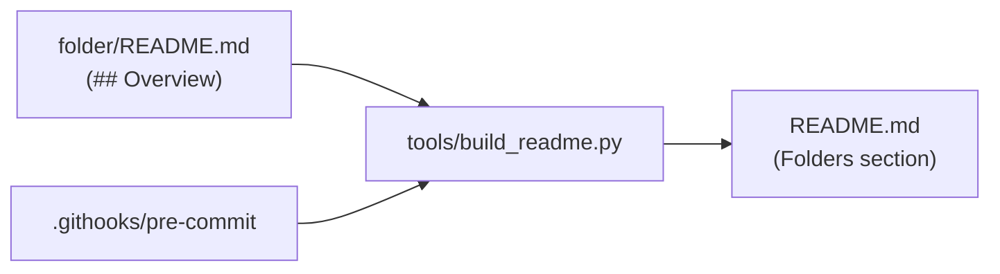

# Python

## Overview
Personal Python learning repository: small exercises, algorithm experiments and a few
finished tools, each in its own folder. Every folder has a short `README.md`; their
overviews are collected automatically in [Folders](#folders) below.

## Quickstart
- Dev environment: `sudo devpod up .` then `ssh python.devpod`, or open the repository
  in VS Code with "Reopen in Container" (`.devcontainer/`, Python 3.14).
- Start command: `python3 <folder>/<script>.py`, for example `python3 palindrome/main.py "racecar"`.
  Scripts read their input files relative to the current directory, so run them from inside their folder.
- Debug command: `python3 -m pdb <folder>/<script>.py`
- Special start commands:
  - Tests: `cd unit_tests && python3 -m pytest`
  - Rebuild the folder overviews: `python3 tools/build_readme.py` (`--check` only verifies)
- Required environment variables (only for `spotify_api/on_off.py`): `SPOTIPY_CLIENT_ID`,
  `SPOTIPY_CLIENT_SECRET`. Put them in a git-ignored `.env`.

## Architecture
- Each top-level folder is an independent topic with its own scripts and `README.md`.
- `tools/build_readme.py` collects the `## Overview` section of every folder README and
  writes it between the markers in this file.
- `.githooks/pre-commit` runs the builder before every commit and stages `README.md`.
  The dev container activates it with `git config core.hooksPath .githooks`; outside
  the container run that command once yourself.
- Networking: scripts must not hard-code IP addresses, they should come from config or
  environment variables (see the notes for `wled_request`).

## Adding a folder
Create `<folder>/README.md` with a `# Title` and a short `## Overview` section. The next
commit adds it to the list below.

## Dependencies
The dev container image (`.devcontainer/Dockerfile`) installs `pandas`, `black`,
`pyinstaller`, `sqlalchemy`, `spotipy`, `python-dotenv`, `flask` and `pygame-ce`.
Some folders need more packages, install them with `pip` when an import fails.

## Folders
<!-- BEGIN: folder-overviews (generated by tools/build_readme.py, do not edit) -->

### [cardgame](cardgame/)

UNO card game for the terminal, written in Python 3.10+ (2 to 8 players, colored ANSI output, all special cards). Start it with `python3 main.py`.

### [conditionals](conditionals/)

Exercises on comparison operators, `if`/`elif`/`else`, `match` (Python's switch) and conditions inside functions.

### [conditionals_complex](conditionals_complex/)

Practice scripts that combine loops and conditions, for example iterating over a list of Hogwarts students.

### [controller_tester](controller_tester/)

Flask web app that tests gamepad vibration on Linux using pygame. Start it with `python3 vibration_tester.py` and open `http://localhost:5000`.

### [exceptions](exceptions/)

Exception handling and debugging exercises: validated integer input with `try`/`except` and a pyramid printer to debug.

### [fake_student_data](fake_student_data/)

Generates fake German student names with Faker and writes one CSV list per course (basis and lk) into `csv_student_lists/`.

### [file_io](file_io/)

Reading and writing files: text files, CSV files (students, Hogwarts houses), sorting names and opening images with Pillow.

### [functions_variables](functions_variables/)

Basics of variables, functions, integer versus float division and a small calculator.

### [gui](gui/)

Tkinter scripts: a CSV merge tool (`ai.py`), a small calculator, a menu demo (`function_tk.py`) and a CSV-to-Excel converter (`convert.py`).

### [lambdas](lambdas/)

Lambda examples: squaring a number and a function that returns a power lambda.

### [letter_counter](letter_counter/)

Counts how often a letter occurs in a word, in several variants (interactive input and command-line arguments).

### [libraries](libraries/)

Using standard and third-party libraries: `random`, `statistics`, `cowsay`, an iTunes search request and importing from an own module (`say.py` uses `sayings.py`).

### [little_things](little_things/)

Tiny scripts, currently a star pyramid printer.

### [math_algorithms](math_algorithms/)

Sorting (bubble, insertion, selection), a heap, Fibonacci (recursive, iterative, cached, with a benchmark), factorial, the Ackermann function, lexicographic comparison and a triangle surface area.

### [metronome](metronome/)

Plays a pattern of low and high beeps with `winsound` (Windows only).

### [misc](misc/)

Assorted exercises: classes (`Account`, `Cat`), `argparse`, generators, argument unpacking and text-to-speech/cowsay.

### [notebooks](notebooks/)

Jupyter notebook with first experiments (`01_demo.ipynb`).

### [number_guessing](number_guessing/)

Terminal number guessing game that supports number bases from 2 to 128. Start it with `python3 main.py`.

### [oop](oop/)

Class exercises: `Hat`, `Student`, `Vault`, `Wizard` and a look at `type`.

### [palindrome](palindrome/)

Command-line tool that checks strings or JSON word lists for palindromes. See `help.md` for usage.

### [pdf_crack](pdf_crack/)

Scripts to encrypt a PDF (`PDFEncrypter.py`) and to brute-force the password of a PDF you own (`PDFCracker.py`). Only use it on your own files.

### [pygames](pygames/)

pygame experiments: a first program, a Pong start and a scenes demo.

### [regexes](regexes/)

Exercises with the `re` module: formatting names, validating input and searching or substituting text.

### [scratch](scratch/)

Throwaway experiments that do not belong anywhere else.

### [spotify_api](spotify_api/)

Spotify Web API scripts: a track lookup (`api_request.py`) and an OAuth script based on `spotipy` (`on_off.py`). Credentials come from environment variables or a git-ignored `.env`.

### [student_list_sorter](student_list_sorter/)

Tkinter tool that reads the student CSV lists of a folder and writes an overview of which lists each student is in. Includes sample lists and a PyInstaller spec.

### [style_guide](style_guide/)

Notes on PEP 8 and the tools `pylint` and `black`.

### [substitution_cipher](substitution_cipher/)

Command-line tool (`krypt.py`) that replaces single letters in a text, e.g. `python3 krypt.py n=b s=o "text"`.

### [templates](templates/)

Starter templates for a class and for a function.

### [tkinter_game](tkinter_game/)

Work-in-progress Tkinter canvas game (`game.py`). The script still contains typos and does not run yet.

### [unit_tests](unit_tests/)

`pytest` examples: tests for a `square` function and a `hello` function. Run them from this folder with `python3 -m pytest`.

### [wled_request](wled_request/)

Python scripts that control WLED devices (ESP32 LED controllers) over their HTTP JSON API: toggle power, set a color, and two config-driven setters for several devices (`claude/` and `deepseek/`).

<!-- END: folder-overviews -->

## Notes
Older learning notes are kept in [docs/notes.md](docs/notes.md).
